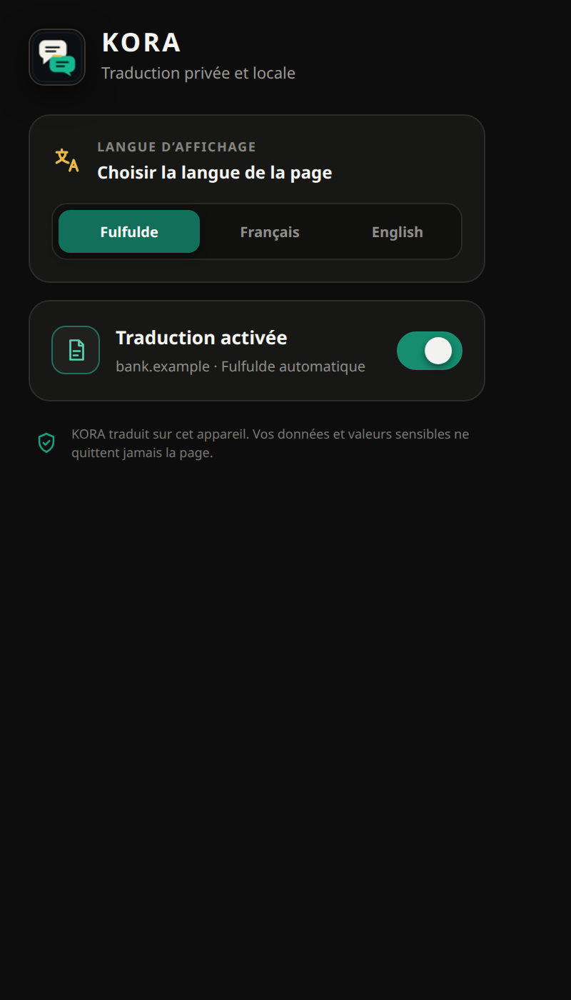

# KORA

**KORA** est une extension Chrome locale qui traduit les pages web du français ou de l’anglais vers le **fulfulde de l’Adamaoua (`fub`)**. Elle a été conçue pour le SAFINUM Innovate Challenge 2026, puis structurée comme une base réutilisable pour les interfaces financières camerounaises.

KORA fonctionne sans serveur de traduction, sans API distante, sans télémétrie et sans transmission du contenu des pages.



## Pourquoi KORA

Une traduction financière ne doit jamais transformer `25 000 FCFA`, inverser « crédité » et « débité », traduire un nom ou affaiblir une alerte de sécurité. KORA privilégie donc une traduction vérifiable :

- français et anglais vers Adamawa Fulfulde `fub`;
- contenu statique et dynamique;
- montants, noms, comptes, téléphones, dates et références conservés;
- sens financier critique couvert à 100 % ou texte original maintenu;
- exécution entièrement hors ligne;
- paquet largement inférieur à la limite de 10 Mio.

## Installation

Chrome ne charge pas directement une archive ZIP.

1. Ouvrir `chrome://extensions`.
2. Activer **Mode développeur**.
3. Cliquer **Charger l’extension non empaquetée**.
4. Sélectionner le dossier `release/kora-unpacked`.
5. Ouvrir ou actualiser la page à traduire.

Alternative : décompresser `release/kora-extension.zip`, puis sélectionner le dossier décompressé contenant directement `manifest.json`.

## Utilisation

La popup reste volontairement simple :

- `Fulfulde` active la détection FR/EN et la traduction vers `fub`;
- `Français` ou `English` restaure le texte original et déclenche le sélecteur natif du site lorsqu’il existe;
- l’interrupteur active ou restaure la traduction immédiatement.

Le contenu ajouté après le chargement est traduit automatiquement. Sur `chrome://`, le Chrome Web Store et les autres pages protégées par le navigateur, Chrome interdit l’injection d’extensions.

## Petit modèle linguistique embarqué

KORA 1.2 contient une première base d’intelligence linguistique légère :

- modèle interpolé unigramme/bigramme/trigramme;
- entraîné sur 1 067 phrases Adamawa Fulfulde de Common Voice 27, sous licence CC0;
- 9 368 tokens Common Voice, 208 formulations KORA relues, 1 061 mots fréquents et 1 264 contextes prédictifs;
- prédiction du mot suivant avec repli trigramme → bigramme → unigramme;
- score de fluidité déterministe pour classer plusieurs formulations sûres;
- environ 55 Kio avant minification, fortement compressé dans le ZIP.

Le modèle de langue n’invente jamais le sens de la source. Il classe uniquement les traductions déjà autorisées par le moteur sémantique. Cette séparation est essentielle :

```text
Texte FR/EN
  ├─ détection de langue
  ├─ verrouillage des noms et valeurs
  ├─ extraction du sens financier critique
  ├─ mémoire bilingue / gabarits / phrasebook
  ├─ contrôle de couverture sémantique
  ├─ modèle fub de prédiction et score de fluidité
  └─ restauration exacte des valeurs ou abstention
```

Un petit n-gramme ne remplace pas un grand modèle neuronal de traduction. Sous la contrainte de 10 Mio et sans corpus parallèle `fub` suffisamment large et validé, cette architecture hybride est plus sûre qu’un modèle génératif miniature qui produirait des contresens.

## Intégrité et confidentialité

KORA ne modifie jamais :

- les valeurs des champs `input`, `textarea` et `select`;
- les noms propres et notes utilisateur;
- les montants, signes, séparateurs, pourcentages et devises;
- les numéros de compte et de téléphone;
- les références, codes et dates.

Chaque valeur sensible doit apparaître exactement autant de fois dans la sortie que dans l’original. En cas d’échec, la phrase source reste affichée. Aucun `fetch`, WebSocket, proxy ou service externe n’est utilisé à l’exécution.

## Couverture

- parcours Safinum : tableau de bord, frais, bénéficiaire, récapitulatif et reçu;
- erreurs et alertes de sécurité;
- authentification, code OTP/PIN et session;
- carte, paiement, dépôt, retrait et transfert;
- compte, historique, relevé, crédit, prêt et remboursement;
- interfaces web générales et contenu injecté dynamiquement.

## Développement

Prérequis : Node.js 20+, Python 3 et Google Chrome.

```bash
npm install
npm run build:icons
npm run build:model
npm run model:demo
npm test
npm run test:popup
npm run test:pages
npm run test:live
npm run package
```

`npm run package` produit :

- `release/kora-extension.zip` pour la livraison;
- `release/kora-unpacked` pour l’installation directe dans Chrome.

La construction échoue automatiquement si le ZIP dépasse 10 Mio.

## Validation

La suite vérifie :

- détection FR/EN et parité vers le même `fub`;
- prédiction du mot suivant et score de fluidité reproductible;
- noms arbitraires sans personne codée en dur;
- valeurs sensibles restaurées octet pour octet;
- refus des phrases financières incomplètement comprises;
- popup sombre, sélecteur Fulfulde/Français/English et activation immédiate;
- pages bancaires génériques FR/EN;
- parcours Safinum complet en navigateur réel;
- contenu dynamique et bascule de langue.

## Structure

```text
src/
  content.js                 analyse et traduction du DOM
  engine.js                  pipeline sémantique et intégrité
  translations.js            mémoire Safinum relue
  general-translations.js    phrasebook financier général
  fub-language-model.js      modèle n-gramme compact généré
  language-model.js          prédiction et score de fluidité
  popup.*                    interface dark à un interrupteur
scripts/
  build_fub_language_model.py
  generate_icons.py
  model_demo.mjs
  build.mjs
  package.mjs
tests/
  engine.test.mjs
  popup.test.mjs
  pages.test.mjs
  live.test.mjs
```

## Sources linguistiques

- Common Voice 27 Adamawa Fulfulde `fub`, CC0;
- Tourneux & Konaï, vocabulaire mobile du Cameroun septentrional, CC BY 4.0;
- dictionnaires et vocabulaires SIL consultés selon leurs conditions;
- corrections Adamawa documentées dans `docs/LINGUISTIC_VALIDATION.md`.

PanLex et le dictionnaire SIL complet ne sont pas redistribués : leurs conditions ne permettent pas une intégration commerciale sans clarification ou autorisation écrite.

## Équipe KORA

- **AZAB A RANGA FRANCK MIGUEL** — coordination et contact  
  Téléphone : [+237 686 826 745](tel:+237686826745)  
  E-mail : [miguel.azab@facsciences-uy1.cm](mailto:miguel.azab@facsciences-uy1.cm)
- **BELL AQIL**
- **SIMO SIGEU NKOUAMKAM MENELIK**

## Limites

KORA est un prototype avancé, pas encore un dispositif bancaire certifié. Avant un déploiement public, les traductions critiques doivent être relues à l’aveugle par au moins deux locuteurs `fub` de l’Adamaoua, avec publication du taux d’abstention et des résultats de compréhension.

## Licence

Code KORA : MIT. Les ressources linguistiques conservent leurs licences respectives.
