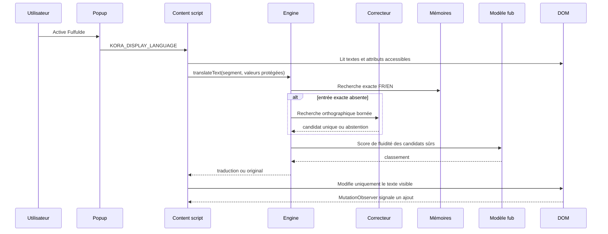
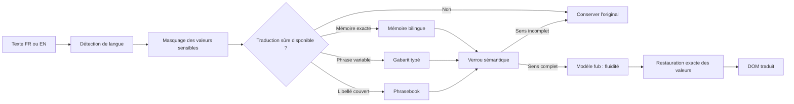
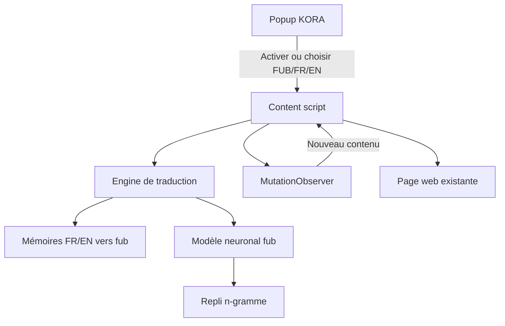

<p align="center">
  
</p>

<h1 align="center">KORA</h1>

<p align="center">
  <strong>La traduction financière privée et locale, en fulfulde de l’Adamaoua.</strong>
</p>

<p align="center">
  <a href="#installation">Installer</a> ·
  <a href="release/KORA_Demo_Pitch_SAFINUM_2026.webm">Voir la démo réelle</a> ·
  <a href="release/KORA-Documentation-SAFINUM.pdf">Lire le dossier technique</a> ·
  <a href="docs/ARCHITECTURE.md">Explorer l’architecture</a>
</p>

KORA est une extension Chrome qui traduit les pages web du français ou de
l’anglais vers le **fulfulde de l’Adamaoua (`fub`)**. Elle fonctionne sans
serveur de traduction, sans API distante, sans télémétrie et sans transmission
du contenu des pages.

Conçue pour le SAFINUM Innovate Challenge 2026, la solution est structurée
comme une base réutilisable pour les interfaces financières camerounaises :
code source, corpus traçables, modèles embarqués, tests automatisés et paquet
installable sont réunis dans ce dépôt.

<p align="center">
  
</p>

## L’essentiel

Une traduction financière ne doit jamais transformer `25 000 FCFA`, inverser « crédité » et « débité », traduire un nom ou affaiblir une alerte de sécurité. KORA privilégie donc une traduction vérifiable :

- français et anglais vers Adamawa Fulfulde `fub`;
- contenu statique et dynamique;
- montants, noms, comptes, téléphones, dates et références conservés;
- sens financier critique couvert à 100 % ou texte original maintenu;
- exécution entièrement hors ligne;
- paquet largement inférieur à la limite de 10 Mio.

### Livrables SAFINUM

- [Vidéo pitch-démo réelle — 2 min 20 s, 6,93 Mio](release/KORA_Demo_Pitch_SAFINUM_2026.webm)
- [Documentation technique complète — 10 pages A4, 740 Kio](release/KORA-Documentation-SAFINUM.pdf)
- [Extension Chrome prête à remettre — 254,3 Kio](release/kora-extension.zip)
- [Guide de démonstration](docs/DEMO.md)
- [Validation et résultats](docs/VALIDATION.md)
- [Checklist et valeurs du formulaire](submission/SUBMISSION_CHECKLIST.md)

## Installation

Chrome ne charge pas directement une archive ZIP.

1. Ouvrir `chrome://extensions`.
2. Activer **Mode développeur**.
3. Cliquer **Charger l’extension non empaquetée**.
4. Sélectionner le dossier `release/kora-unpacked`.
5. Ouvrir ou actualiser la page à traduire.

Alternative : décompresser `release/kora-extension.zip`, puis sélectionner le dossier décompressé contenant directement `manifest.json`.

## Utilisation

La popup reste volontairement simple :

- `Fulfulde` active la détection FR/EN et la traduction vers `fub`;
- `Français` ou `English` restaure le texte original et déclenche le sélecteur natif du site lorsqu’il existe;
- l’interrupteur active ou restaure la traduction immédiatement.

Après une action, la popup se ferme et rend le focus à la page. Les raccourcis
du navigateur et du site, notamment `Ctrl+A`, restent utilisables.

Le contenu ajouté après le chargement est traduit automatiquement. Le
correcteur orthographique couvre toutes les entrées textuelles traduisibles
des mémoires FR/EN :

- accents omis et ponctuation variable;
- lettre manquante, ajoutée ou remplacée;
- lettres voisines inversées;
- jusqu’à quatre opérations sur une phrase longue.

Ainsi `sodle insufisant` est rapproché de `solde insuffisant`, puis traduit en
`Kaalisi yonaa`. La distance autorisée augmente avec la longueur du texte.
KORA exige une meilleure correspondance unique; si deux sens concurrents sont
aussi proches, le texte original reste affiché.

KORA surveille les surfaces DOM accessibles au navigateur :

- nœuds ajoutés par `append`, `innerHTML`, fragments ou rendu de framework;
- texte remplacé après chargement;
- `placeholder`, `aria-label` et `title` modifiés;
- options visibles sans modification de leur valeur technique;
- Shadow DOM ouvert;
- cadres et iframes où Chrome autorise le content script.

Les valeurs de champs financiers ou personnels restent intactes. Un champ explicitement destiné à fournir une phrase de test dynamique est traité comme une source à traduire, sans modifier la valeur du champ lui-même.

Les Shadow DOM fermés, le texte dessiné dans un `<canvas>`, les images et les pages protégées comme `chrome://` ou le Chrome Web Store ne sont pas accessibles aux extensions.

### Pourquoi la page jury ou une page d’administration est traduite

KORA ne contient aucune règle « jury » ou « admin ». Lorsque Fulfulde est
activé, le content script traduit tout texte visible et accessible de la page,
qu’il appartienne à un client, un administrateur ou un outil d’évaluation.
C’est le comportement normal d’une extension de traduction générale et cela
permet au jury de vérifier les ajouts dynamiques. Les valeurs saisies, codes et
identifiants restent protégés. Pour conserver une interface administrative
dans sa langue source, il suffit de désactiver KORA ou de choisir Français /
English dans la popup.

## Architecture et rôle des composants

- `manifest.json` déclare Manifest V3, les permissions locales, les icônes, la
  popup et l’injection du content script dans les pages ordinaires.
- `src/popup.js` lit l’état de l’onglet, active/restaure la traduction et
  demande au sélecteur natif du site de passer en français ou en anglais.
- `src/content.js` parcourt le DOM, protège les champs, observe les mutations,
  traduit les attributs visibles et restaure exactement les nœuds originaux.
- `src/engine.js` orchestre la langue source, l’intégrité financière, les
  mémoires, le correcteur, les gabarits et l’abstention.
- `src/spelling.js` indexe toutes les clés FR/EN et calcule une distance
  Damerau–Levenshtein bornée. Il ne choisit une correction que si le meilleur
  sens est unique.
- `src/translations.js` porte la mémoire bilingue du parcours Safinum.
- `src/general-translations.js` couvre les interfaces web et financières
  générales.
- `src/corpus-translations.js` est généré depuis les 504 concepts financiers;
  il expose 391 clés FR, 390 clés EN et 113 codes à conserver.
- `src/language-model.js` fusionne prédiction neuronale et n-gramme, puis
  classe uniquement des formulations dont le sens est déjà connu.
- `src/neural-language-model.js` exécute les tenseurs int8 contenus dans
  `src/fub-neural-model.js`.
- `chrome.storage.local` conserve seulement activation et langue d’affichage;
  aucun texte de page n’y est enregistré.



La description détaillée des contrats d’intégration se trouve dans
[`docs/INTEGRATION.md`](docs/INTEGRATION.md), et les schémas complets dans
[`docs/ARCHITECTURE.md`](docs/ARCHITECTURE.md).

## Modèle linguistique embarqué

KORA embarque une base d’intelligence linguistique légère et entièrement locale :

- réseau neuronal à contexte de trois mots, 185 120 paramètres, poids int8;
- couche d’embedding de 24 dimensions et couche cachée de 96 neurones;
- vocabulaire neuronal de 1 472 unités;
- entraîné sur 1 067 phrases Adamawa Fulfulde de Common Voice 27, sous licence CC0;
- 9 368 tokens Common Voice, 262 formulations de la mémoire KORA et 386
  formulations terminologiques candidates à poids réduit;
- repli n-gramme de 1 199 mots fréquents et 1 561 contextes prédictifs;
- prédiction neuronale du mot suivant avec repli n-gramme déterministe;
- score de fluidité déterministe pour classer plusieurs formulations sûres;
- cache local des 1 000 derniers scores pour éviter de recalculer les libellés répétés;
- arrêt anticipé reproductible : meilleur état obtenu à l’époque 2 sur 8
  exécutées;
- validation séparée sur 107 phrases Common Voice : top-1 14,8 %, top-5 35,0 %;
- environ 262 Kio de poids, vocabulaire et métadonnées avant minification.

Le réseau neuronal est réellement exécuté dans l’extension : chaque traduction acceptée passe par `scoreFubFluency`, qui appelle l’inférence int8, et le classement de plusieurs candidats utilise sa probabilité avec un repli n-gramme. Ce réseau n’est toutefois pas un traducteur libre : il prédit la fluidité en `fub` et ne peut ni modifier un montant, ni autoriser seul une action financière.





Ce réseau ne remplace pas un grand modèle neuronal de traduction. Sous la contrainte de 10 Mio et sans corpus parallèle `fub` suffisamment large et validé, son rôle limité de classement est plus sûr qu’un modèle génératif susceptible de produire des contresens.

### Embarquement et exécution dans Chrome

Le modèle est inclus dans l’extension, pas téléchargé au premier lancement :

1. `scripts/train_fub_neural_model.py` génère les poids int8 et le vocabulaire
   dans `src/fub-neural-model.js`;
2. `src/neural-language-model.js` réalise l’inférence matricielle en JavaScript,
   sans PyTorch dans Chrome;
3. `src/language-model.js` combine 85 % de prédiction neuronale et 15 % de
   repli n-gramme pour le mot suivant; le score de phrase combine ensuite
   80 % de score neuronal et 20 % de score n-gramme;
4. `src/engine.js` obtient d’abord un candidat sûr depuis les mémoires,
   gabarits ou termes contrôlés, puis demande au modèle de classer sa fluidité;
5. `npm run build` regroupe le moteur, les poids et les mémoires dans
   `dist/content.js`; `npm run package` copie ce bundle dans
   `release/kora-unpacked/content.js` et dans le ZIP.

À l’exécution, il n’existe donc aucun appel réseau, aucun chargement différé
de poids et aucune dépendance Python. Désactiver Internet ne change pas le
pipeline. Le JSON exportable est destiné à l’audit ou à une autre intégration;
l’extension exécute directement les modules JavaScript générés.

### Test réel du modèle

`npm run model:demo` exécute les poids int8 utilisés par le bundle. Les sorties reproductibles vérifient notamment :

- `transfeer maa` → candidats `yettaama`, `neldaama`;
- `kaalisi` → candidats `gonɗi`, `yonaa`;
- `Votre paiement de 25 000 FCFA a été refusé.` → `Yoɓugol maa 25 000 FCFA salaama.`;
- une négation inconnue comme `Le transfert n'a pas échoué.` est conservée en français.

Les métriques, la séparation entraînement/validation et les sorties observées sont détaillées dans [`docs/MODEL_EVALUATION.md`](docs/MODEL_EVALUATION.md).

### Exporter le modèle entraîné

```bash
npm run model:export
```

Cette commande produit `release/kora-fub-neural-model.json`, un artefact portable contenant :

- métadonnées d’architecture et métriques;
- vocabulaire `fub`;
- tenseurs int8 et échelles de quantification;
- empreinte SHA-256 de contrôle.

L’implémentation de référence pour l’inférence se trouve dans `src/neural-language-model.js`. L’export ne contient aucune donnée utilisateur ni contenu provenant des pages visitées.

### Réentraîner et utiliser le modèle

Le procédé reproductible est :

```bash
npm run build:corpora
npm run build:terminology
npm run build:model
npm run model:train
npm run model:export
npm run model:demo
```

- `build:corpora` inventorie les 512 libellés sources et contrôle les
  chevauchements;
- `build:terminology` compile les 504 concepts FR/EN→`fub` et protège les 113
  codes;
- `build:model` régénère le repli n-gramme;
- `model:train` entraîne le réseau, garde le meilleur état de validation,
  quantifie les poids et produit le module exécutable;
- `model:export` produit le JSON autonome avec son empreinte;
- `model:demo` charge exactement les poids livrés et affiche prédictions,
  scores et cas d’abstention.

L’API interne est disponible depuis `src/language-model.js` :

```js
import {
  predictNextFub,
  rankFubCandidates,
  scoreFubFluency
} from "./src/language-model.js";
```

`predictNextFub` propose les mots suivants, `scoreFubFluency` note une
formulation `fub` et `rankFubCandidates` trie plusieurs formulations déjà
sûres. Ces fonctions ne traduisent pas seules une phrase FR/EN.

### Utiliser le moteur complet séparément

Pour traduire une chaîne FR/EN, il faut importer le moteur, pas seulement le
modèle de fluidité :

```js
import { translateText } from "./src/engine.js";

const result = translateText("sodle insufisant", {
  sourceHint: "fr",
  domainHint: "financial",
  protectedValues: []
});

console.log(result.text);   // Kaalisi yonaa
console.log(result.method); // spelling-memory
```

Le résultat contient `text`, `changed`, `source`, `method` et, lorsqu’une
formulation `fub` a été produite, son score `fluency`. Pour une application
Node ou un autre bundler JavaScript, copier `src/engine.js` avec ses modules
générés et exécuter d’abord :

```bash
npm run build:terminology
npm run build:model
```

Pour intégrer seulement le modèle de langue dans un autre produit, importer
`predictNextFub`, `scoreFubFluency` ou `rankFubCandidates`. Le fichier
`release/kora-fub-neural-model.json` convient à un autre runtime : il contient
le vocabulaire, les métadonnées, les tenseurs int8 et leurs échelles. Le code
de référence qui montre comment reconstruire l’inférence se trouve dans
`src/neural-language-model.js`. L’artefact seul ne fournit pas la traduction
FR/EN : les mémoires et `translateText` restent nécessaires.

## Intégrité et confidentialité

KORA ne modifie jamais :

- les valeurs des champs `input`, `textarea` et `select`;
- les noms propres et notes utilisateur;
- les montants, signes, séparateurs, pourcentages et devises;
- les numéros de compte et de téléphone;
- les références, codes et dates.

Chaque valeur sensible doit apparaître exactement autant de fois dans la sortie que dans l’original. En cas d’échec, la phrase source reste affichée. Aucun `fetch`, WebSocket, proxy ou service externe n’est utilisé à l’exécution.

Dans un `<select>`, seul le libellé visible d’une option est traduit. Sa propriété `value`, utilisée par le formulaire et le serveur, reste inchangée.

## Couverture

- parcours Safinum : tableau de bord, frais, bénéficiaire, récapitulatif et reçu;
- erreurs et alertes de sécurité;
- inventaires financiers fournis : banque, transaction, monétique, crédit,
  investissement, comptabilité, conformité, microfinance, fiscalité, API et
  litiges — 512 libellés, 504 concepts dédupliqués, 113 codes protégés;
- contenu dynamique et contrôles d’intégrité financière;
- correction conservatrice de plusieurs fautes bornées lorsqu’un seul sens
  connu correspond;
- authentification, code OTP/PIN et session;
- carte, paiement, dépôt, retrait et transfert;
- compte, historique, relevé, crédit, prêt et remboursement;
- interfaces web générales et contenu ajouté dynamiquement.

La terminologie compilée expose 391 clés françaises et 390 clés anglaises
pour 504 concepts. Elle alimente 386 formulations `fub` distinctes dans
l’entraînement à poids réduit. Cette surface s’ajoute aux 262 formulations
historiques KORA et aux gabarits capables de conserver des valeurs variables.

Le test orthographique parcourt 1 252 libellés textuels réellement
traduisibles : 628 français et 624 anglais. Pour chacun, il génère des
variantes avec suppression, duplication ou inversion de lettre et exige de
retrouver exactement la même sortie. Les entrées contenant des nombres, les
codes techniques et les valeurs personnelles sont volontairement exclues de
la correction approximative.

« Contenu dynamique » signifie tout texte réellement exposé au DOM accessible :
nœud ajouté ou remplacé, attribut visible, option, Shadow DOM ouvert ou iframe
autorisée. Une image, un canvas, un Shadow DOM fermé ou une page
`chrome://` n’expose pas son texte à une extension. Une phrase libre dont le
sens n’existe dans aucune mémoire ou aucun gabarit reste également intacte :
le modèle de fluidité ne doit pas inventer sa traduction.

## Développement

Prérequis : Node.js 20+, Python 3 et Google Chrome. Le réentraînement optionnel du réseau demande un environnement `.venv` avec PyTorch et NumPy; les poids générés sont déjà versionnés pour construire l’extension sans PyTorch.

```bash
npm install
npm run build:icons
npm run build:corpora
npm run build:terminology
npm run build:model
npm run model:train
npm run model:export
npm run model:demo
npm test
npm run test:spelling
npm run test:popup
npm run test:pages
npm run test:live
npm run test:uba
npm run test:all
npm run package
npm run submission:capture
npm run submission:pdf
npm run submission:video
```

`npm run package` produit :

- `release/kora-extension.zip` pour la livraison;
- `release/kora-unpacked` pour l’installation directe dans Chrome.

La construction échoue automatiquement si le ZIP dépasse 10 Mio.

Les commandes `submission:*` reproduisent les captures, le dossier PDF et la
vidéo remis au jury. La vidéo charge réellement KORA dans un profil Chrome
propre et parcourt la page Safinum normale, sans panneau jury ni injection.
Sa narration utilise la voix ElevenLabs Lucie avec une clé locale
`ELEVENLABS_API_KEY`; ce service de production n’est jamais utilisé par
l’extension et ne reçoit aucun contenu de page.

## Validation

La suite vérifie :

- détection FR/EN et parité vers le même `fub`;
- prédiction du mot suivant et score de fluidité reproductible;
- noms arbitraires sans personne codée en dur;
- valeurs sensibles restaurées octet pour octet;
- correction orthographique de 1 252 entrées FR/EN, accents et cas
  multifaute, avec abstention en cas d’ambiguïté;
- refus des phrases financières incomplètement comprises;
- popup sombre, sélecteur Fulfulde/Français/English et activation immédiate;
- pages bancaires génériques FR/EN;
- parcours Safinum complet en navigateur réel;
- contenu dynamique et bascule de langue;
- texte, attributs, Shadow DOM ouvert et iframes;
- conservation de `Payment for services` lorsqu’il s’agit d’une saisie;
- traduction live de `hello mon frere qui est tu` et `sodle insufisant` après
  ajout dynamique.

## Structure

```text
src/
  content.js                 analyse et traduction du DOM
  engine.js                  pipeline sémantique et intégrité
  spelling.js                correction orthographique bornée et non ambiguë
  translations.js            mémoire Safinum relue
  general-translations.js    phrasebook financier général
  corpus-translations.js     terminologie financière FR/EN générée
  fub-language-model.js      modèle n-gramme compact généré
  fub-neural-model.js        poids neuronaux int8 générés
  neural-language-model.js   inférence neuronale JavaScript
  language-model.js          fusion neuronale et repli n-gramme
  popup.*                    interface dark et sélecteur FUB/FR/EN
scripts/
  build_corpus_translations.mjs
  build_fub_language_model.py
  train_fub_neural_model.py
  export_neural_model.mjs
  generate_icons.py
  model_demo.mjs
  build.mjs
  package.mjs
tests/
  engine.test.mjs
  spelling.test.mjs
  corpus.test.mjs
  popup.test.mjs
  pages.test.mjs
  live.test.mjs
  uba-live.test.mjs
data/corpora/
  corpus_terminologique_financier_volume_1.txt
  corpus_finance_transactionnelle_volume_2.txt
  financial-terminology-candidates.json
  index.json
```

## Sources linguistiques

- Common Voice 27 Adamawa Fulfulde `fub`, CC0;
- Tourneux & Konaï, vocabulaire mobile du Cameroun septentrional, CC BY 4.0;
- dictionnaires et vocabulaires SIL consultés selon leurs conditions;
- corrections Adamawa documentées dans `docs/LINGUISTIC_VALIDATION.md`.
- deux inventaires financiers fournis au projet, avec provenance, empreintes et
  exclusions documentées dans [`docs/FINANCIAL_CORPORA.md`](docs/FINANCIAL_CORPORA.md).

PanLex et le dictionnaire SIL complet ne sont pas redistribués : leurs conditions ne permettent pas une intégration commerciale sans clarification ou autorisation écrite.

Les deux inventaires financiers fournis au projet sont conservés dans le dépôt
avec leur empreinte, leur absence de licence déclarée et leurs exclusions
explicites. Ils ne sont pas embarqués bruts dans l’extension et ne sont jamais
présentés comme un corpus parallèle `fub`.

## Équipe KORA

- **AZAB A RANGA FRANCK MIGUEL** — coordination et contact  
  Téléphone : [+237 686 826 745](tel:+237686826745)  
  E-mail : [miguel.azab@facsciences-uy1.cm](mailto:miguel.azab@facsciences-uy1.cm)
- **BELL AQIL**
- **SIMO SIGEU NKOUAMKAM MENELIK**

## Validation linguistique

- **M. JEAN-ERNEST SOUROUMBAI** — responsable de la validation linguistique du projet.

## Limites

KORA est une extension fonctionnelle, mais pas un dispositif bancaire certifié. Avant un déploiement public, les traductions critiques doivent être relues à l’aveugle par au moins deux locuteurs `fub` de l’Adamaoua, avec publication du taux d’abstention et des résultats de compréhension.

## Licence

Code KORA : MIT. Les ressources linguistiques conservent leurs licences respectives.
