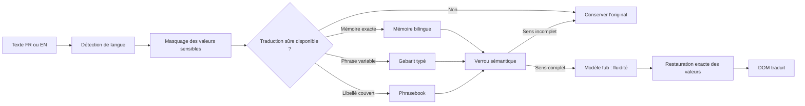
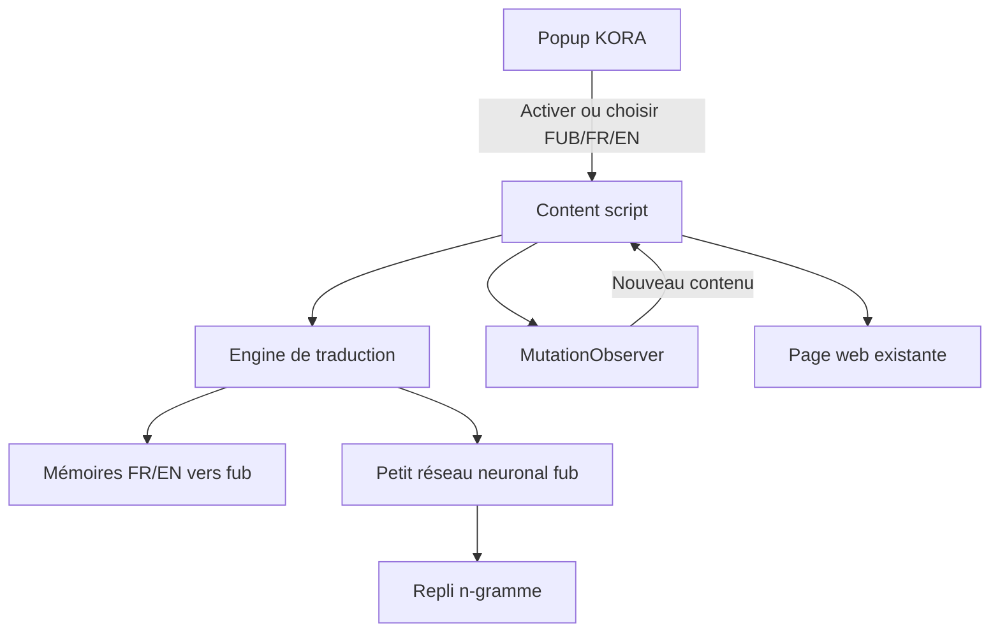

# KORA

<p align="center">
  
</p>

**KORA** est une extension Chrome locale qui traduit les pages web du français ou de l’anglais vers le **fulfulde de l’Adamaoua (`fub`)**. Elle a été conçue pour le SAFINUM Innovate Challenge 2026, puis structurée comme une base réutilisable pour les interfaces financières camerounaises.

KORA fonctionne sans serveur de traduction, sans API distante, sans télémétrie et sans transmission du contenu des pages.

Le manifest fournit des icônes optimisées en `16`, `32`, `48` et `128` pixels. La marque remplit presque tout le canevas avec un fond émeraude contrasté afin de rester visible dans le sélecteur d’extensions, dont la taille d’affichage est imposée par Chrome.


## Pourquoi KORA

Une traduction financière ne doit jamais transformer `25 000 FCFA`, inverser « crédité » et « débité », traduire un nom ou affaiblir une alerte de sécurité. KORA privilégie donc une traduction vérifiable :

- français et anglais vers Adamawa Fulfulde `fub`;
- contenu statique et dynamique;
- montants, noms, comptes, téléphones, dates et références conservés;
- sens financier critique couvert à 100 % ou texte original maintenu;
- exécution entièrement hors ligne;
- paquet largement inférieur à la limite de 10 Mio.

## Installation

Chrome ne charge pas directement une archive ZIP.

1. Ouvrir `chrome://extensions`.
2. Activer **Mode développeur**.
3. Cliquer **Charger l’extension non empaquetée**.
4. Sélectionner le dossier `release/kora-unpacked`.
5. Ouvrir ou actualiser la page à traduire.

Alternative : décompresser `release/kora-extension.zip`, puis sélectionner le dossier décompressé contenant directement `manifest.json`.

## Utilisation

La popup reste volontairement simple :

- `Fulfulde` active la détection FR/EN et la traduction vers `fub`;
- `Français` ou `English` restaure le texte original et déclenche le sélecteur natif du site lorsqu’il existe;
- l’interrupteur active ou restaure la traduction immédiatement.

Le contenu ajouté après le chargement est traduit automatiquement.

KORA surveille les surfaces DOM accessibles au navigateur :

- nœuds ajoutés par `append`, `innerHTML`, fragments ou rendu de framework;
- texte remplacé après chargement;
- `placeholder`, `aria-label` et `title` modifiés;
- options visibles sans modification de leur valeur technique;
- Shadow DOM ouvert;
- cadres et iframes où Chrome autorise le content script.

Les valeurs de champs financiers ou personnels restent intactes. Un champ explicitement destiné à fournir une phrase de test dynamique est traité comme une source à traduire, sans modifier la valeur du champ lui-même.

Les Shadow DOM fermés, le texte dessiné dans un `<canvas>`, les images et les pages protégées comme `chrome://` ou le Chrome Web Store ne sont pas accessibles aux extensions.

## Petit modèle linguistique embarqué

KORA embarque une base d’intelligence linguistique légère et entièrement locale :

- réseau neuronal à contexte de deux mots, 77 104 paramètres, poids int8;
- couche d’embedding de 24 dimensions et couche cachée de 48 neurones;
- entraîné sur 1 067 phrases Adamawa Fulfulde de Common Voice 27, sous licence CC0;
- 9 368 tokens Common Voice, 243 formulations KORA relues, 1 101 mots fréquents et 1 385 contextes prédictifs;
- prédiction neuronale du mot suivant avec repli n-gramme déterministe;
- score de fluidité déterministe pour classer plusieurs formulations sûres;
- cache local des 1 000 derniers scores pour éviter de recalculer les libellés répétés;
- validation séparée sur 107 phrases Common Voice : top-1 13,4 %, top-5 32,6 %;
- environ 114 Kio de poids, vocabulaire et métadonnées avant minification.

Le réseau neuronal est réellement exécuté dans l’extension : chaque traduction acceptée passe par `scoreFubFluency`, qui appelle l’inférence int8, et le classement de plusieurs candidats utilise sa probabilité avec un repli n-gramme. Ce réseau n’est toutefois pas un traducteur libre : il prédit la fluidité en `fub` et ne peut ni modifier un montant, ni autoriser seul une action financière.





Ce petit réseau ne remplace pas un grand modèle neuronal de traduction. Sous la contrainte de 10 Mio et sans corpus parallèle `fub` suffisamment large et validé, son rôle limité de classement est plus sûr qu’un modèle génératif miniature susceptible de produire des contresens.

### Test réel du modèle

`npm run model:demo` exécute les poids int8 utilisés par le bundle. Les sorties reproductibles vérifient notamment :

- `transfeer maa` → candidats `yettaama`, `neldaama`;
- `kaalisi` → candidats `gonɗi`, `yonaa`;
- `Votre paiement de 25 000 FCFA a été refusé.` → `Yoɓugol maa 25 000 FCFA salaama.`;
- une négation inconnue comme `Le transfert n'a pas échoué.` est conservée en français.

Les métriques, la séparation entraînement/validation et les sorties observées sont détaillées dans [`docs/MODEL_EVALUATION.md`](docs/MODEL_EVALUATION.md).

### Exporter le modèle entraîné

```bash
npm run model:export
```

Cette commande produit `release/kora-fub-neural-model.json`, un artefact portable contenant :

- métadonnées d’architecture et métriques;
- vocabulaire `fub`;
- tenseurs int8 et échelles de quantification;
- empreinte SHA-256 de contrôle.

L’implémentation de référence pour l’inférence se trouve dans `src/neural-language-model.js`. L’export ne contient aucune donnée utilisateur ni contenu provenant des pages visitées.

## Intégrité et confidentialité

KORA ne modifie jamais :

- les valeurs des champs `input`, `textarea` et `select`;
- les noms propres et notes utilisateur;
- les montants, signes, séparateurs, pourcentages et devises;
- les numéros de compte et de téléphone;
- les références, codes et dates.

Chaque valeur sensible doit apparaître exactement autant de fois dans la sortie que dans l’original. En cas d’échec, la phrase source reste affichée. Aucun `fetch`, WebSocket, proxy ou service externe n’est utilisé à l’exécution.

Dans un `<select>`, seul le libellé visible d’une option est traduit. Sa propriété `value`, utilisée par le formulaire et le serveur, reste inchangée.

## Couverture

- parcours Safinum : tableau de bord, frais, bénéficiaire, récapitulatif et reçu;
- erreurs et alertes de sécurité;
- contenu dynamique et contrôles d’intégrité financière;
- authentification, code OTP/PIN et session;
- carte, paiement, dépôt, retrait et transfert;
- compte, historique, relevé, crédit, prêt et remboursement;
- interfaces web générales et contenu ajouté dynamiquement.

## Développement

Prérequis : Node.js 20+, Python 3 et Google Chrome. Le réentraînement optionnel du réseau demande un environnement `.venv` avec PyTorch et NumPy; les poids générés sont déjà versionnés pour construire l’extension sans PyTorch.

```bash
npm install
npm run build:icons
npm run build:model
npm run model:train
npm run model:export
npm run model:demo
npm test
npm run test:popup
npm run test:pages
npm run test:live
npm run package
```

`npm run package` produit :

- `release/kora-extension.zip` pour la livraison;
- `release/kora-unpacked` pour l’installation directe dans Chrome.

La construction échoue automatiquement si le ZIP dépasse 10 Mio.

## Validation

La suite vérifie :

- détection FR/EN et parité vers le même `fub`;
- prédiction du mot suivant et score de fluidité reproductible;
- noms arbitraires sans personne codée en dur;
- valeurs sensibles restaurées octet pour octet;
- refus des phrases financières incomplètement comprises;
- popup sombre, sélecteur Fulfulde/Français/English et activation immédiate;
- pages bancaires génériques FR/EN;
- parcours Safinum complet en navigateur réel;
- contenu dynamique et bascule de langue;
- texte, attributs, Shadow DOM ouvert et iframes;
- conservation de `Payment for services` lorsqu’il s’agit d’une saisie;
- traduction live de `hello mon frere qui est tu` après ajout dynamique.

## Structure

```text
src/
  content.js                 analyse et traduction du DOM
  engine.js                  pipeline sémantique et intégrité
  translations.js            mémoire Safinum relue
  general-translations.js    phrasebook financier général
  fub-language-model.js      modèle n-gramme compact généré
  fub-neural-model.js        poids neuronaux int8 générés
  neural-language-model.js   inférence neuronale JavaScript
  language-model.js          fusion neuronale et repli n-gramme
  popup.*                    interface dark et sélecteur FUB/FR/EN
scripts/
  build_fub_language_model.py
  train_tiny_fub_neural.py
  export_neural_model.mjs
  generate_icons.py
  model_demo.mjs
  build.mjs
  package.mjs
tests/
  engine.test.mjs
  popup.test.mjs
  pages.test.mjs
  live.test.mjs
```

## Sources linguistiques

- Common Voice 27 Adamawa Fulfulde `fub`, CC0;
- Tourneux & Konaï, vocabulaire mobile du Cameroun septentrional, CC BY 4.0;
- dictionnaires et vocabulaires SIL consultés selon leurs conditions;
- corrections Adamawa documentées dans `docs/LINGUISTIC_VALIDATION.md`.

PanLex et le dictionnaire SIL complet ne sont pas redistribués : leurs conditions ne permettent pas une intégration commerciale sans clarification ou autorisation écrite.

## Équipe KORA

- **AZAB A RANGA FRANCK MIGUEL** — coordination et contact  
  Téléphone : [+237 686 826 745](tel:+237686826745)  
  E-mail : [miguel.azab@facsciences-uy1.cm](mailto:miguel.azab@facsciences-uy1.cm)
- **BELL AQIL**
- **SIMO SIGEU NKOUAMKAM MENELIK**

## Validation linguistique

- **M. JEAN ERNSET SOUROUMBAI** — responsable de la validation linguistique du projet.

## Limites

KORA est une extension fonctionnelle, mais pas un dispositif bancaire certifié. Avant un déploiement public, les traductions critiques doivent être relues à l’aveugle par au moins deux locuteurs `fub` de l’Adamaoua, avec publication du taux d’abstention et des résultats de compréhension.

## Licence

Code KORA : MIT. Les ressources linguistiques conservent leurs licences respectives.
