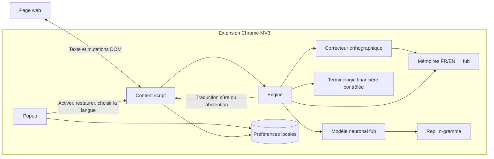
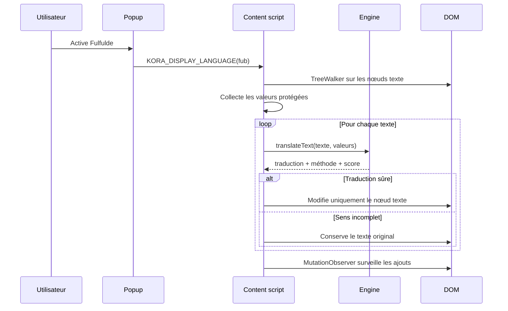
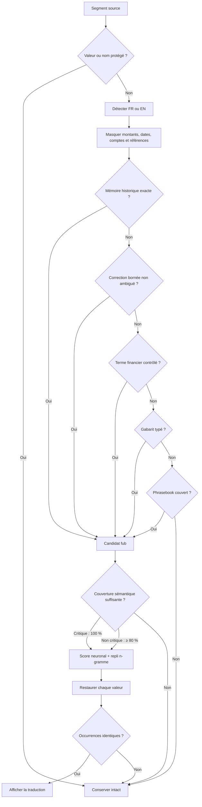
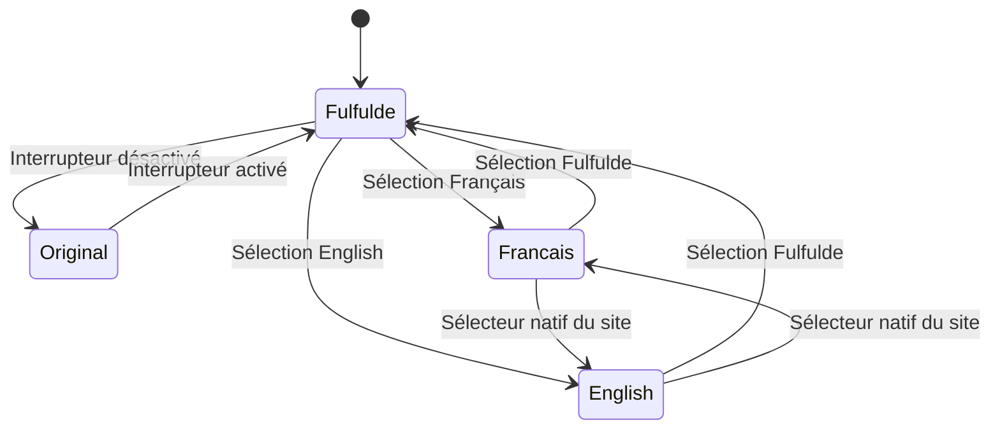
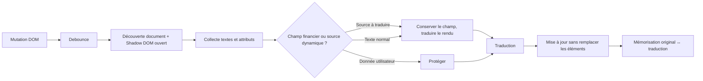
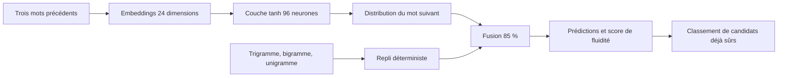
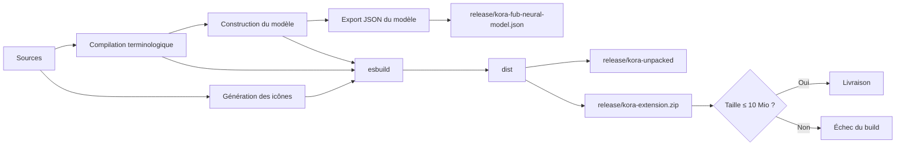

# Architecture de KORA

## Objectif

KORA est une extension Chrome Manifest V3 qui traduit une page web existante du français ou de l’anglais vers le fulfulde de l’Adamaoua (`fub`). Le site ne fournit aucun hook, identifiant de traduction ou contrat `data-i18n`.

Contraintes structurantes :

- archive inférieure à 10 Mio;
- aucune donnée de page envoyée sur le réseau;
- montants, noms, comptes et références intacts;
- contenu dynamique traité sans rechargement;
- phrase financière ambiguë conservée dans sa langue source.

## Vue d’ensemble

La popup ne traduit rien directement. Elle pilote le content script de l’onglet actif. Le moteur et toutes ses ressources sont embarqués dans `content.js`.

## Séquence d’exécution

## Pipeline de traduction

Ordre des méthodes :

1. mémoire exacte Safinum;
2. mémoire générale web et financière;
3. terminologie dédupliquée des corpus financiers;
4. gabarit avec emplacements typés;
5. phrasebook longest-match;
6. abstention.

La terminologie étendue est activée dans un contexte financier ou lorsque le
segment contient lui-même un marqueur financier non ambigu. Cette porte évite,
par exemple, de traduire le mot français « action » comme un titre boursier sur
une page sans rapport avec la finance.

Le rapprochement orthographique normalise accents et ponctuation, puis accepte
une à quatre opérations selon la longueur : insertion, suppression,
substitution ou inversion adjacente. Il ne retient le résultat que si le
meilleur sens est unique. Les 1 252 libellés textuels traduisibles possèdent
chacun un test de variante générée; nombres, codes et valeurs personnelles
sont exclus de ce rapprochement. Le modèle de langue n’autorise jamais une
traduction. Il classe uniquement plusieurs formulations déjà acceptées par le
verrou sémantique.

## Sélection Fulfulde, Français et English

Pour `Français` ou `English`, KORA :

1. restaure tous ses nœuds traduits;
2. désactive la traduction;
3. cherche un bouton, lien ou `<select>` natif du site;
4. déclenche ce contrôle s’il existe;
5. sinon laisse la page dans sa langue source.

KORA ne fabrique pas une traduction FR↔EN : cette fonctionnalité appartient au site visité.

## Protection des données

Les invariants suivants sont contrôlés avant chaque rendu :

- une valeur sensible apparaît exactement autant de fois dans la sortie que dans l’entrée;
- la valeur d’un `input`, `textarea` ou `select` ne change jamais;
- le libellé visible d’une `<option>` peut être traduit, mais son attribut `value` reste identique;
- un nom complet n’est jamais translittéré;
- aucun nombre, signe ou code n’est créé;
- une négation financière inconnue provoque l’abstention.

Le masquage produit des jetons internes temporaires, par exemple `⟪KORA_0⟫`. Ces jetons n’apparaissent jamais dans le DOM final.

## Contenu dynamique

`MutationObserver` surveille :

- nouveaux écrans d’une application monopage;
- alertes et erreurs;
- recalcul des frais;
- changement de langue du site;
- `aria-label`, `title` et `placeholder`;
- boutons, liens, labels et options;
- racines Shadow DOM ouvertes;
- cadres où le navigateur autorise le content script.

Les mutations produites par `append`, `innerHTML`, `DocumentFragment`, remplacement de `textContent` et rendu de framework suivent le même pipeline. Les Shadow DOM fermés, le contenu d’un canvas, les pixels d’une image et les pages internes protégées par Chrome ne sont pas exposés à une extension et restent donc hors périmètre technique.

Le pipeline n’identifie pas un rôle « jury » ou « administrateur ». Une page
administrative est traduite comme toute autre page lorsque KORA est active.
Cette neutralité évite un couplage au site de soumission et permet de démontrer
les mutations sur l’environnement jury sans règle dédiée.

Un garde global versionné empêche l’initialisation multiple. Si une ancienne version du content script est encore attachée à l’onglet, la popup recharge la page une fois pour installer le protocole courant.

## Modèle de langue

`scripts/train_fub_neural_model.py` entraîne le réseau puis génère
`src/fub-neural-model.js`. `src/neural-language-model.js` exécute ses poids
int8 directement en JavaScript, sans bibliothèque d’inférence. Le n-gramme
généré par `scripts/build_fub_language_model.py` reste un repli déterministe.

Corpus :

- 1 067 phrases Common Voice 27 `fub`, CC0;
- 262 formulations historiques de la mémoire KORA;
- 386 formulations terminologiques candidates à poids réduit;
- 9 368 tokens Common Voice;
- 1 472 unités dans le vocabulaire neuronal;
- 1 199 mots fréquents;
- 1 561 contextes prédictifs.

Le réseau compte 185 120 paramètres. Ses poids, son vocabulaire et ses
métadonnées occupent environ 262 Kio avant minification. L’entraînement utilise
un arrêt anticipé : sur le run reproductible final, le meilleur état est celui
de l’époque 2 et l’exécution s’arrête après 8 époques. Sur 107 phrases Common
Voice tenues hors entraînement, le modèle int8 atteint 14,8 % top-1 et 35,0 %
top-5. La top-5 est la métrique la plus pertinente pour son rôle de classement
de plusieurs candidats. Un cache borné conserve les 1 000 derniers scores afin
que les libellés répétés ne relancent pas l’inférence. Ces métriques restent
distinctes d’une qualité de traduction : le modèle complète le moteur
déterministe mais ne remplace pas un modèle neuronal de traduction générale.

## Modules

- `src/content.js` : DOM, mutations, restauration et messages popup;
- `src/engine.js` : intégrité, couverture et cascade de traduction;
- `src/spelling.js` : index orthographique, distance bornée et abstention;
- `src/translations.js` : parcours Safinum bilingue;
- `src/general-translations.js` : web, finance, éducation et assistants;
- `src/corpus-translations.js` : index FR/EN généré depuis la terminologie contrôlée;
- `src/language-model.js` : prédiction et score de fluidité;
- `src/fub-language-model.js` : paramètres générés;
- `src/fub-neural-model.js` : poids neuronaux int8 générés;
- `src/neural-language-model.js` : inférence neuronale locale;
- `src/popup.*` : interface utilisateur;
- `scripts/export_neural_model.mjs` : export JSON portable du modèle int8;
- `scripts/build_corpus_translations.mjs` : validation et compilation des corpus;
- `scripts/build.mjs` : bundle Chrome;
- `scripts/package.mjs` : ZIP et dossier unpacked.

## Construction et livraison

Le paquet final contient uniquement le manifest, les bundles incluant les
poids KORA, la popup et quatre tailles d’icône. Aucun corpus brut, modèle tiers
ni dépendance de développement n’est livré.
