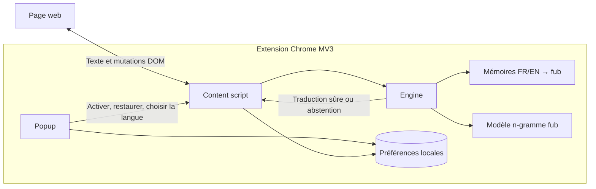
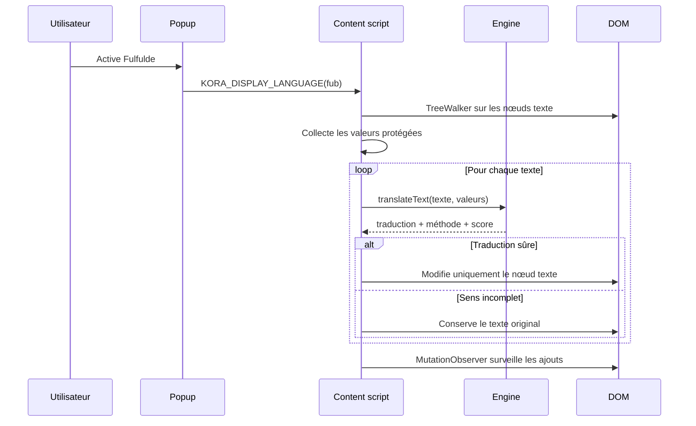
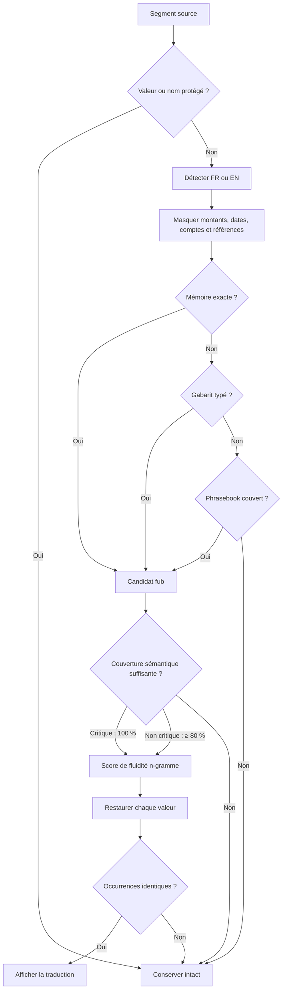
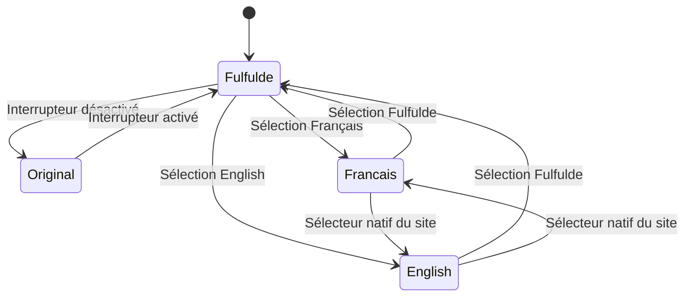
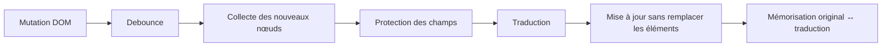
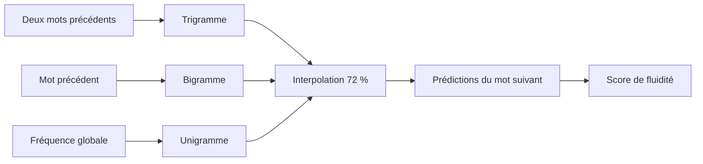
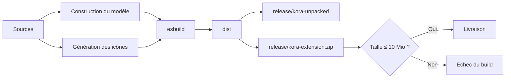

# Architecture de KORA

## Objectif

KORA est une extension Chrome Manifest V3 qui traduit une page web existante du français ou de l’anglais vers le fulfulde de l’Adamaoua (`fub`). Le site ne fournit aucun hook, identifiant de traduction ou contrat `data-i18n`.

Contraintes structurantes :

- archive inférieure à 10 Mio;
- aucune donnée de page envoyée sur le réseau;
- montants, noms, comptes et références intacts;
- contenu dynamique traité sans rechargement;
- phrase financière ambiguë conservée dans sa langue source.

## Vue d’ensemble

La popup ne traduit rien directement. Elle pilote le content script de l’onglet actif. Le moteur et toutes ses ressources sont embarqués dans `content.js`.

## Séquence d’exécution

## Pipeline de traduction

Ordre des méthodes :

1. mémoire exacte Safinum;
2. mémoire générale web et financière;
3. gabarit avec emplacements typés;
4. phrasebook longest-match;
5. abstention.

Le modèle de langue n’autorise jamais une traduction. Il classe uniquement plusieurs formulations déjà acceptées par le verrou sémantique.

## Sélection Fulfulde, Français et English

Pour `Français` ou `English`, KORA :

1. restaure tous ses nœuds traduits;
2. désactive la traduction;
3. cherche un bouton, lien ou `<select>` natif du site;
4. déclenche ce contrôle s’il existe;
5. sinon laisse la page dans sa langue source.

KORA ne fabrique pas une traduction FR↔EN : cette fonctionnalité appartient au site visité.

## Protection des données

Les invariants suivants sont contrôlés avant chaque rendu :

- une valeur sensible apparaît exactement autant de fois dans la sortie que dans l’entrée;
- la valeur d’un `input`, `textarea` ou `select` ne change jamais;
- le libellé visible d’une `<option>` peut être traduit, mais son attribut `value` reste identique;
- un nom complet n’est jamais translittéré;
- aucun nombre, signe ou code n’est créé;
- une négation financière inconnue provoque l’abstention.

Le masquage produit des jetons internes temporaires, par exemple `⟪KORA_0⟫`. Ces jetons n’apparaissent jamais dans le DOM final.

## Contenu dynamique

`MutationObserver` surveille :

- nouveaux écrans d’une application monopage;
- alertes et erreurs;
- recalcul des frais;
- changement de langue du site;
- `aria-label`, `title` et `placeholder`;
- boutons, liens, labels et options.

Un garde global versionné empêche l’initialisation multiple. Si une ancienne version du content script est encore attachée à l’onglet, la popup recharge la page une fois pour installer le protocole courant.

## Petit modèle de langue

Le fichier `src/fub-language-model.js` est généré par `scripts/build_fub_language_model.py`.

Corpus :

- 1 067 phrases Common Voice 27 `fub`, CC0;
- 208 formulations KORA relues;
- 9 368 tokens Common Voice;
- 1 061 mots fréquents;
- 1 264 contextes prédictifs.

Le modèle pèse environ 55 Kio avant minification. Il complète le moteur déterministe mais ne remplace pas un modèle neuronal de traduction générale.

## Modules

- `src/content.js` : DOM, mutations, restauration et messages popup;
- `src/engine.js` : intégrité, couverture et cascade de traduction;
- `src/translations.js` : parcours Safinum bilingue;
- `src/general-translations.js` : web, finance, éducation et assistants;
- `src/language-model.js` : prédiction et score de fluidité;
- `src/fub-language-model.js` : paramètres générés;
- `src/popup.*` : interface utilisateur;
- `scripts/build.mjs` : bundle Chrome;
- `scripts/package.mjs` : ZIP et dossier unpacked.

## Construction et livraison

Le paquet final contient uniquement le manifest, les bundles, la popup et quatre tailles d’icône. Aucun corpus brut, modèle tiers ou dépendance de développement n’est livré.
