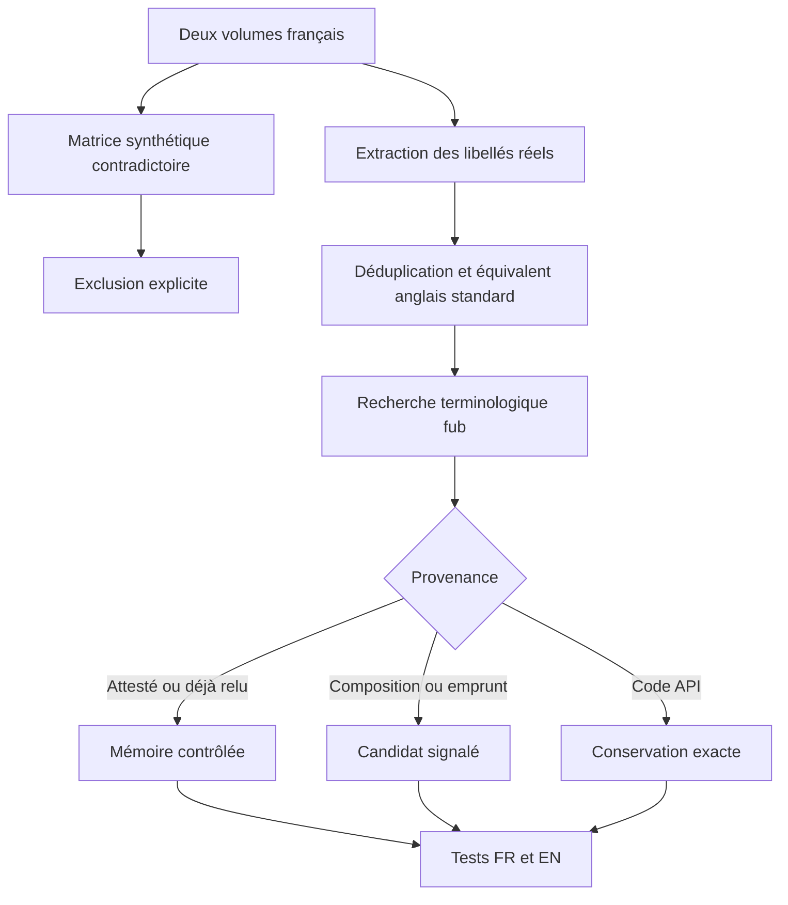

# Corpus financiers et terminologie contrôlée

## Objet

KORA conserve deux inventaires financiers fournis par l’équipe :

- `corpus_terminologique_financier_volume_1.txt` : banque, paiements,
  monétique, crédit, investissement, comptabilité, conformité, microfinance,
  fiscalité et finance numérique;
- `corpus_finance_transactionnelle_volume_2.txt` : cycles de transaction,
  statuts, erreurs, événements, alertes, options, API et litiges.

Ils totalisent 2 859 lignes et 512 libellés, soit 504 concepts après
déduplication de huit chevauchements. Les acronymes et codes en majuscules sont
comptés comme des entrées lorsqu’ils possèdent une définition. Les empreintes,
sections et libellés
extraits sont enregistrés dans
`data/corpora/index.json`.

## Ce que ces fichiers prouvent — et ne prouvent pas

Les deux volumes sont rédigés en français. Ils donnent des définitions et des
exemples utiles pour distinguer les concepts, mais ne contiennent aucune
traduction anglaise ou Adamawa Fulfulde. Ils ne peuvent donc pas être utilisés
comme vérité parallèle FR/EN→`fub`.

Le volume 2 se termine par une matrice de 512 phrases synthétiques. Elle est
exclue de l’entraînement et de la mémoire de traduction : 32 lignes associent
une réussite à une cause d’échec, et d’autres présentent des erreurs d’accord.
Les intégrer dégraderait précisément les messages financiers que KORA doit
sécuriser.



## Statuts

- `attested` : forme retrouvée dans une ressource linguistique autorisée;
- `reviewed-existing` : forme déjà présente dans la mémoire KORA relue;
- `compositional-candidate` : assemblage transparent à faire relire;
- `local-loan-candidate` : emprunt technique cohérent avec l’usage local, à
  faire confirmer;
- `preserved-code` : identifiant technique qui ne doit jamais être traduit.

Le statut accompagne les données dans
`data/corpora/financial-terminology-candidates.json`. Une entrée candidate est
utilisable pour élargir l’interface demandée, mais n’est jamais présentée dans
la documentation comme une attestation indépendante.

Distribution actuelle des 504 concepts :

- 20 reprennent exactement une formulation KORA déjà relue;
- 340 sont des compositions candidates;
- 31 sont des emprunts techniques candidats;
- 113 sont des codes ou identifiants conservés;
- aucune nouvelle forme n’est marquée `attested` sur la seule base des deux
  volumes français.

## Sources de recoupement

1. Tourneux et Konaï, vocabulaire de téléphonie mobile du Cameroun
   septentrional, CC BY 4.0;
2. Common Voice Adamawa Fulfulde `fub`, CC0, pour l’orthographe et la
   modélisation de fluidité;
3. ressources SIL consultables, sans extraction ni redistribution;
4. manuel technique Peace Corps, comme source secondaire inter-dialectale;
5. terminologie financière institutionnelle francophone, pour la
   désambiguïsation des concepts;
6. comparaison ponctuelle Google Translate vers le macrocode `ff`, jamais
   importée automatiquement.

Les cinq réponses Google relevées le 14 novembre 2026 sont conservées dans
`data/corpora/google-ff-comparison.json`. Elles montrent pourquoi une sortie
`ff` ne doit pas être assimilée sans contrôle au `fub` camerounais.

Une note linguistique fournie par l’équipe le même jour corrige huit formes
ou distinctions morphologiques : compte bloqué, date de valeur, découvert
autorisé, paiement récurrent, paiement sans contact, paiement marchand,
remboursement et rétrofacturation. Sa provenance est inscrite dans `sources`
sur les entrées concernées. Cette note ne transforme pas automatiquement les
propositions compositionnelles en formes `attested`.

## Intégration à l’extension

`scripts/build_corpus_translations.mjs` compile les entrées vers deux index
normalisés :

```text
français ─┐
          ├── même formulation fub et même statut conceptuel
anglais ──┘
```

La mémoire historique KORA garde la priorité. Le corpus étendu complète les
libellés absents sans remplacer les traductions déjà relues. Les codes HTTP,
identifiants d’événement, clés d’idempotence, références et noms restent
inchangés.

## Effet sur le modèle

Les formulations `fub` servent au modèle uniquement comme phrases de
terminologie à faible poids. Elles n’entrent pas dans la validation Common
Voice et ne transforment pas le réseau en traducteur génératif. Les
formulations historiques de la mémoire KORA conservent un poids
d’entraînement supérieur.

Le modèle continue à classer des candidats dont le sens a déjà été déterminé
par la mémoire ou un gabarit; il n’est jamais autorisé à inventer une
traduction financière.

## Contrôles obligatoires

- chaque libellé inventorié possède une entrée FR, EN et `fub` ou un statut
  `preserved-code`;
- aucune définition française n’est entraînée comme si elle était du `fub`;
- toutes les valeurs numériques restent identiques;
- les chevauchements entre les volumes produisent la même sortie;
- les entrées historiques KORA ne régressent pas;
- le ZIP reste inférieur à 10 Mio;
- les candidats critiques doivent encore être relus par deux locuteurs avant
  un déploiement bancaire certifié.
