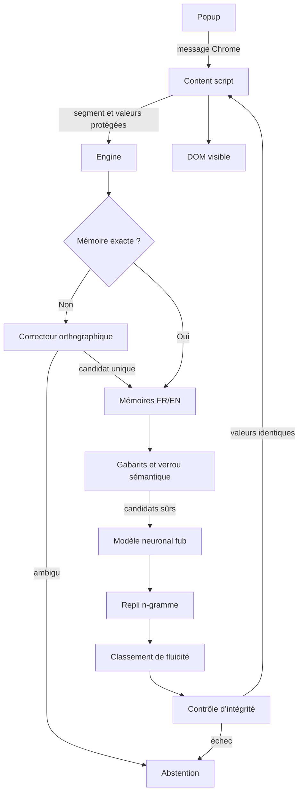

# Intégrer et utiliser KORA

## Ce qui est réellement livré

KORA contient deux couches distinctes :

1. le moteur de traduction contrôlée FR/EN→`fub`, qui connaît les mémoires,
   les gabarits, la terminologie, la protection des valeurs et l’orthographe;
2. le modèle de langue `fub`, qui prédit les mots suivants et classe la
   fluidité de formulations déjà sûres.

Le modèle de langue ne traduit pas seul. `translateText` détermine le sens,
protège les données, produit les candidats puis appelle le modèle. Cette
séparation évite qu’une probabilité linguistique invente une action bancaire.

## Dialogue entre l’extension et le modèle



Le content script ne transmet jamais le DOM au modèle en bloc. Il envoie un
segment à `translateText`. Le modèle reçoit uniquement une formulation `fub`
candidate après détermination du sens. Les montants, comptes, téléphones,
références et valeurs de formulaire sont masqués ou protégés avant ce passage.

## Rôle de chaque composant

### Extension Chrome

- `manifest.json` définit l’action, les permissions, les icônes et les pages
  où le content script peut s’exécuter.
- `src/popup.html`, `src/popup.css` et `src/popup.js` constituent l’interface.
  La popup envoie des messages mais ne traduit aucun texte.
- `src/content.js` collecte les nœuds, valeurs protégées et attributs; il
  observe aussi les mutations, Shadow DOM ouverts et iframes autorisées.
- `chrome.storage.local` mémorise seulement l’activation et la langue choisie.

### Traduction contrôlée

- `src/engine.js` expose `translateText` et applique la cascade de décision.
- `src/spelling.js` normalise accents et ponctuation, puis utilise une distance
  Damerau–Levenshtein bornée. Il accepte seulement un meilleur sens unique.
- `src/translations.js` contient les formulations Safinum FR/EN.
- `src/general-translations.js` couvre les interfaces générales.
- `src/corpus-translations.js` contient l’index financier généré.
- les gabarits traduisent des phrases variables tout en restaurant chaque
  valeur sensible octet pour octet.

### Modèles de langue

- `src/fub-neural-model.js` contient vocabulaire, métadonnées et tenseurs int8.
- `src/neural-language-model.js` réalise l’inférence matricielle sans
  bibliothèque externe.
- `src/fub-language-model.js` contient unigrammes, bigrammes et trigrammes.
- `src/language-model.js` expose prédiction, score et classement hybrides.

### Construction

- `scripts/build_corpus_translations.mjs` valide les 504 concepts et génère les
  index FR/EN.
- `scripts/build_fub_language_model.py` génère le repli n-gramme.
- `scripts/train_fub_neural_model.py` entraîne, sélectionne, quantifie et
  exporte le réseau dans un module JavaScript.
- `scripts/export_neural_model.mjs` produit le JSON portable.
- `scripts/build.mjs` crée le bundle Chrome.
- `scripts/package.mjs` crée le dossier unpacked et le ZIP, avec contrôle de
  taille.

## Utiliser le moteur complet

Dans un projet JavaScript ESM :

```js
import { translateText } from "./src/engine.js";

const result = translateText("insuficient balnce", {
  sourceHint: "en",
  domainHint: "financial",
  protectedValues: []
});

if (result.changed) {
  console.log(result.text);   // Kaalisi yonaa
  console.log(result.method); // spelling-memory
}
```

Options :

- `sourceHint` : `auto`, `fr` ou `en`;
- `domainHint` : `general` ou `financial`;
- `protectedValues` : chaînes qui doivent rester strictement intactes.

Résultat :

- `text` : traduction ou original;
- `changed` : indique si le texte a changé;
- `source` : langue détectée;
- `method` : `memory`, `spelling-memory`, `template`, `glossary`,
  `protected`, `protected-code`, `integrity-fallback` ou `original`;
- `fluency` : score du modèle lorsque pertinent.

Avant cette intégration, générer les ressources :

```bash
npm install
npm run build:terminology
npm run build:model
```

## Utiliser uniquement le modèle de langue

```js
import {
  predictNextFub,
  rankFubCandidates,
  scoreFubFluency
} from "./src/language-model.js";

console.log(predictNextFub("transfeer maa", 5));
console.log(scoreFubFluency("Kaalisi yonaa"));
console.log(rankFubCandidates([
  "Transfeer maa neldaama.",
  "Transfeer maa yettaama."
]));
```

- `predictNextFub` propose les prochains mots;
- `scoreFubFluency` calcule un score hybride;
- `rankFubCandidates` trie des formulations déjà validées sémantiquement.

Ne pas utiliser ces fonctions comme traducteur libre. Elles ne connaissent ni
le français ni l’anglais et ne protègent pas les montants.

## Utiliser le JSON exporté

```bash
npm run model:export
```

`release/kora-fub-neural-model.json` contient :

- format et langue;
- métadonnées d’architecture et de validation;
- vocabulaire;
- tenseurs quantifiés en base64;
- échelles de déquantification;
- SHA-256 du contenu.

Pour un runtime différent, reproduire les opérations de
`src/neural-language-model.js` : décodage int8, embeddings des trois mots,
couche tanh, projection de sortie et softmax. Le JSON n’embarque ni les
mémoires FR/EN ni le verrou financier.

## Intégrer l’extension complète

```bash
npm run build
npm run package
```

- intégrer `release/kora-unpacked` dans Chrome en mode développeur;
- distribuer `release/kora-extension.zip` après décompression;
- pour une autre extension MV3, reprendre `content.js`, la popup et les
  permissions du manifest;
- incrémenter `PROTOCOL_VERSION` si le contrat popup/content script change.

## Contenu dynamique et pages administratives

`MutationObserver` repasse chaque ajout accessible dans le même moteur. Le
comportement ne dépend pas de l’URL Safinum, d’un identifiant jury ou d’un
attribut privé. Une page administrative est donc traduite si KORA est active.
Les champs saisis restent inchangés; seul leur libellé visible peut changer.

Les surfaces non accessibles restent hors périmètre : Shadow DOM fermé,
canvas, texte dans une image, Chrome Web Store et pages `chrome://`.

## Tout tester

```bash
npm test
npm run test:spelling
npm run test:popup
npm run test:pages
npm run test:live
npm run test:uba
npm run test:all
npm run package
```

- `npm test` couvre moteur, corpus, modèle exporté et orthographe;
- `test:spelling` génère des fautes sur 1 252 libellés FR/EN;
- `test:popup` vérifie connexion, thème et langues;
- `test:pages` vérifie DOM dynamique, attributs, iframe et Shadow DOM;
- `test:live` parcourt Safinum et ses injections dans Chrome;
- `test:uba` ouvre réellement UBA Cameroon et vérifie `Ctrl+A`;
- `test:all` exécute toute la chaîne;
- `package` vérifie aussi la limite de 10 Mio.
